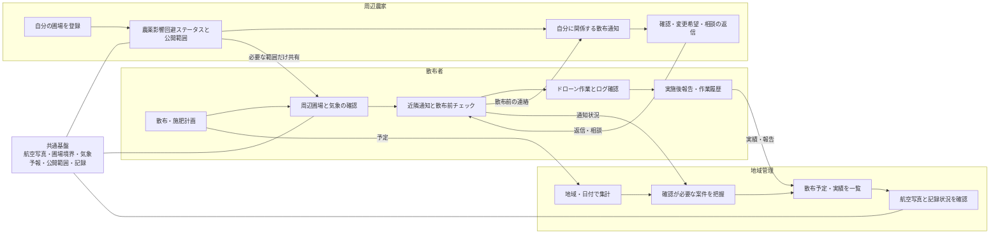

# となり畑セーフティ 機能マップ

最終更新: 2026-07-23

## このサービスを一言でいうと

農薬・肥料を散布する人、周辺農家、地域管理者が、散布前後に必要な情報を共有し、飛散被害を未然に防ぐための確認・連絡・記録サービスです。

このサービスは散布を許可・承認するものではありません。また、被害原因や法的責任を判定するものでもありません。

## 3種類の利用者と全体の流れ

## 現在の機能

記号の意味:

- `実装済み`: 現在のデモで操作できる
- `仮実装`: 画面や処理はあるが、ローカル保存・サンプルデータ・疑似連携
- `基盤のみ`: 内部の受け口はあるが、本番接続は無効
- `未実装`: 将来構想であり、現在は利用できない

### 散布者

| 機能 | 状態 | 現在できること |
| --- | --- | --- |
| トップ | 実装済み | 今日の予定、確認状況、未完了項目、次の対応を確認 |
| 散布計画 | 実装済み | 圃場、日時、農薬・肥料、使用量、機体、操作者、散布条件を登録 |
| 圃場マップ | 実装済み | 航空写真上で散布圃場、周辺圃場、距離、風下方向を確認 |
| 気象確認 | 実装済み | Open-Meteoの予報取得、散布者確認、現地実測メモを分けて記録 |
| 近隣通知 | 仮実装 | 通知文作成と通知状況の管理。LINE・メール等への実送信はしない |
| 散布前チェック | 実装済み | ラベル、周辺、気象、飛行計画、機体・装置等の確認を記録 |
| ドローン連携 | 仮実装 | サンプルまたは取込ログで飛行軌跡、散布ON/OFF、高度を確認 |
| 散布カバレッジ | 仮実装 | 取込済みログの再生から散布済み・未散布範囲を表示 |
| 実施後報告 | 実装済み | 実施内容、実測値、問い合わせ等を記録 |
| 作業履歴 | 実装済み | 散布者メニューと実施後報告から開き、圃場別の履歴をCSV/PDF出力 |
| VRA・処方マップ | 仮実装 | GeoJSONの取込・編集・出力。MVPの主要導線ではなく高度機能 |

### 周辺農家

| 機能 | 状態 | 現在できること |
| --- | --- | --- |
| 通知中心のトップ | 実装済み | 自分に関係する散布予定、未返信、相談中の状況を確認 |
| 圃場マップ | 実装済み | 自分の圃場と近隣の散布予定を航空写真で確認 |
| 圃場ステータス | 実装済み | 有機・農薬不使用、収穫予定、通知希望等を登録 |
| 公開範囲 | 実装済み | 圃場位置、栽培状況、連絡先、返信内容の共有範囲を設定 |
| 通知への返信 | 仮実装 | 確認、時間変更希望、電話相談、収穫・作業予定ありを記録 |

### 地域管理

| 機能 | 状態 | 現在できること |
| --- | --- | --- |
| 地域ダッシュボード | 実装済み | 都道府県、市町村、日付を選び、予定・未通知・未報告等を集計 |
| 確認キュー | 実装済み | 通知未完了、風速要確認、ログ未取込、問い合わせ等を確認 |
| 散布予定・実績 | 実装済み | 誰が、いつ、どこで、何を散布する・したかを一覧表示 |
| 案件詳細 | 実装済み | 行を選び、航空写真、対象圃場、作業内容、確認状況を表示 |
| 承認・許可 | 対象外 | 記録状況の確認画面であり、散布可否を承認しない |

## 共通基盤

| 基盤 | 状態 | 補足 |
| --- | --- | --- |
| MapLibre + 国土地理院航空写真 | 実装済み | 圃場と作業情報の共通表示 |
| GeoJSON / Shapefile圃場境界取込 | 実装済み | CRS・形状検証と安定IDを含む |
| 市町村・筆ポリゴン取込 | 実装済み | デモ地域の境界データを利用 |
| Open-Meteo | 実装済み | 予報値。現地実測の代用にはしない |
| ローカルデータ保存 | 仮実装 | localStorageのみ。端末間共有、認証、監査ログはない |
| 同期境界・保存契約 | 基盤のみ | アカウント・地域・端末データを分離。遠隔保存自体は未接続 |
| プロフィール・ロール切替 | 仮実装 | デモ用。実認証・RBACではない |
| WAGRI / xarvio連携口 | 基盤のみ | 読取専用ゲートウェイはあるが、本番接続は無効 |
| Cloudflare Pages | 実装済み | 公開デモを配信 |

## 将来機能

以下は紹介ページに記載がありますが、現時点では本番機能として利用できません。

| 将来機能 | 現在との差 |
| --- | --- |
| リアルタイム散布カバレッジ | 現在は取込済みログの再生。機体からのライブ受信ではない |
| 未散布エリアのリアルタイム案内 | 現在はカバレッジ表示のみ。操作者への動的な次地点案内はない |
| 自動散布ルート生成 | 現在はルート生成エンジンを実装していない |
| ドローン向けルート出力 | メーカー別フォーマット・SDK連携を実装していない |
| 機体の自律実行 | 実機制御を実装していない |
| LINE・メール等への実通知 | 現在は通知内容と状態のデモ記録のみ |
| 本番認証・共有DB・監査ログ | 現在はブラウザ内のデモ保存のみ |
| WAGRI / xarvio本番連携 | 契約、認証、データ利用条件の確認後に有効化する |

ドローン各社のSDK/API、実施後ログ、ライブテレメトリーの調査結果と
実装優先順位は [DRONE_INTEGRATION.md](DRONE_INTEGRATION.md) を参照してください。
遠隔保存で同期する情報と端末内に残す情報は
[SYNC_BOUNDARY.md](SYNC_BOUNDARY.md) を参照してください。

## このアプリがしないこと

- 「散布可」「散布不可」を法的に判定しない
- 自治体・JAが散布を許可したように見せない
- 被害の原因や責任の所在を断定しない
- 気象予報を現地実測として扱わない
- 周辺農家の情報を必要以上に公開しない
- 現在のデモから実機ドローンを操作しない

## 推奨する開発順

1. ロール別トップと次アクションを完成させ、不要な機能を各ロールから隠す
2. 本番認証、共有データベース、権限制御、監査ログを導入する
3. LINE・メール等の実通知と返信連携を実装する
4. 実機ドローンログを接続し、ライブカバレッジへ進む
5. 自動ルート生成、メーカー別出力、自律実行連携を段階的に追加する
6. WAGRI / xarvioを契約・データ条件に合わせて本番接続する

## 今後、利用者への確認が必要な変更

次の変更は単なる内部改善ではなく、製品の意味や運用を変えるため、実装前に確認します。

- 3種類の利用者の役割や、見られる情報を変える
- 周辺農家の情報公開範囲を広げる
- 散布可否の判断・承認に見える表現を加える
- 通知対象距離や安全確認ルールを変える
- 実機ドローンの制御・自動飛行を有効にする
- 現行機能と将来構想の優先順位を入れ替える

内部構造の整理、テスト追加、表示崩れの修正など、利用者の意味や操作を変えない作業は、この文書を基準に継続します。
